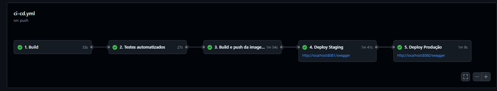
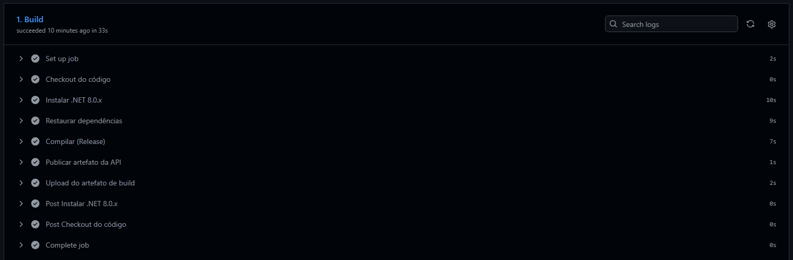
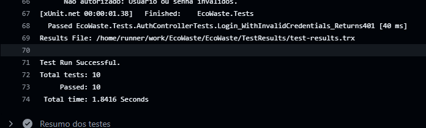
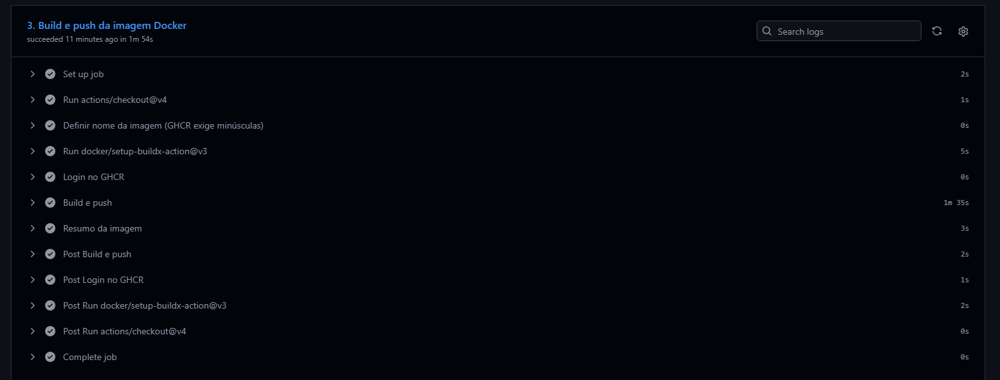
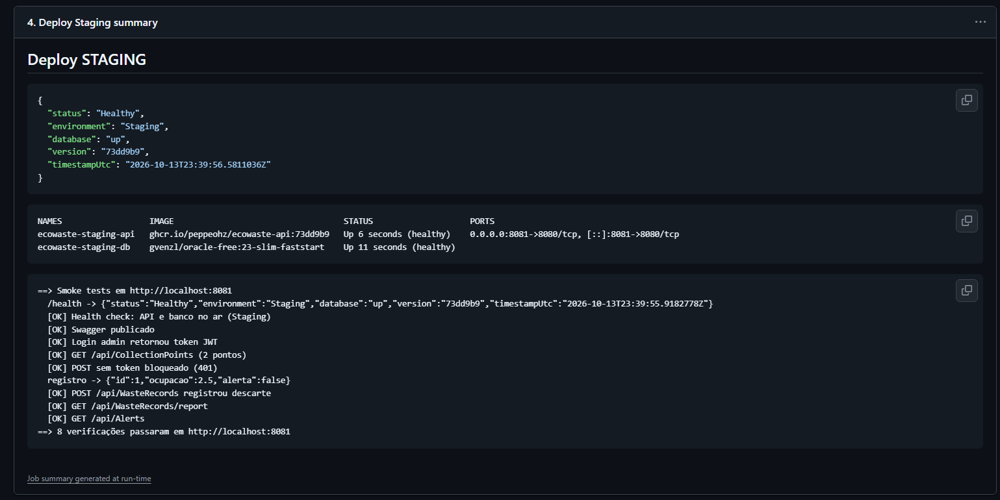
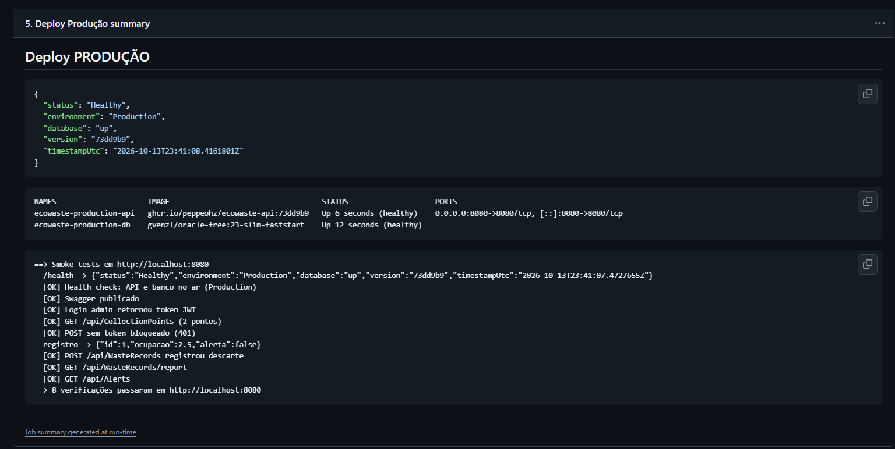

# Projeto - Cidades ESGInteligentes

## EcoWaste API — Gestão de Resíduos e Reciclagem

**Integrante:** Pedro Henrique Zanella — RM 564302

API RESTful em **.NET 8** para o tema ESG **"Gestão de resíduos e reciclagem"** de uma cidade inteligente. Ela rastreia a coleta seletiva por ponto de coleta e gera **alertas automáticos** quando um ponto atinge o limite de ocupação. Também oferece relatórios de reciclagem por tipo de resíduo.

Nesta fase o projeto ganhou práticas de DevOps:

- containerização com **Docker** (multi-stage);
- orquestração com **Docker Compose** (API + banco Oracle, com volumes, redes e variáveis de ambiente);
- pipeline **CI/CD no GitHub Actions** com build, testes e deploy automatizado nos ambientes **staging** e **produção**.

---

## Estrutura do projeto

```
EcoWaste/
├── .github/workflows/ci-cd.yml   # pipeline CI/CD (GitHub Actions)
├── Dockerfile                    # imagem da API (multi-stage)
├── docker-compose.yml            # orquestração: api + db (Oracle)
├── .env.example                  # modelo de variáveis de ambiente
├── env/
│   ├── staging.env               # configuração do ambiente staging
│   └── production.env            # configuração do ambiente produção
├── scripts/
│   ├── deploy.sh                 # deploy de um ambiente via docker compose
│   └── smoke-test.sh             # testes pós-deploy contra a API rodando
├── src/EcoWaste.Api/             # código-fonte da API
├── tests/EcoWaste.Tests/         # testes automatizados (xUnit)
├── docs/                         # documentação (PPT) e prints
├── evidencias/                   # logs/evidências baixados do pipeline
├── EcoWaste.sln
└── README.md
```

---

## Como executar localmente com Docker

**Pré-requisitos:** Docker Desktop (ou Docker Engine) com Docker Compose v2.

1. **Clone o repositório e entre na pasta**
   ```bash
   git clone https://github.com/<PEPPEOHz>/EcoWaste.git
   cd EcoWaste
   ```
2. **Crie o arquivo de variáveis a partir do exemplo** e, se quiser, troque as senhas:
   ```bash
   cp .env.example .env
   ```
3. **Suba os containers.** O build da imagem da API acontece automaticamente:
   ```bash
   docker compose up -d --build
   ```
   O Oracle leva cerca de 1 a 2 minutos para ficar pronto na primeira vez. A API só sobe quando o banco está saudável (`depends_on` + `healthcheck`). Na inicialização ela aplica as **migrations** e popula os dados iniciais.
4. **Acompanhe o status:**
   ```bash
   docker compose ps          # os dois serviços devem ficar "healthy"
   docker compose logs -f api # logs da API
   ```
5. **Acesse:**
   - Swagger: <http://localhost:8080/swagger>
   - Health check: <http://localhost:8080/health>
6. **Teste rápido** (bash, com `curl` e `jq`):
   ```bash
   ./scripts/smoke-test.sh http://localhost:8080
   ```
7. **Para derrubar o ambiente:**
   ```bash
   docker compose down        # mantém os dados (volume)
   docker compose down -v     # remove também o volume do banco
   ```

**Simular staging e produção na sua máquina** (usa as portas 8081 e 8080):
```bash
./scripts/deploy.sh staging       # http://localhost:8081
./scripts/deploy.sh production    # http://localhost:8080
```

**Usuários de teste (seed):**

| Usuário | Senha | Papel |
|---------|-------|-------|
| admin | Admin@123 | Admin |
| operador | Operador@123 | Operator |

**Sem Docker (apenas os testes):** `dotnet test`. Os testes usam banco InMemory.

---

## Pipeline CI/CD

**Ferramenta:** GitHub Actions. O arquivo é `.github/workflows/ci-cd.yml`.

**Gatilhos:**

| Evento | O que roda |
|--------|-----------|
| Pull Request para `main`/`develop` | Build + Testes |
| Push na `develop` | Build + Testes + Imagem + **Deploy Staging** |
| Push na `main` | Build + Testes + Imagem + **Deploy Staging** + **Deploy Produção** |
| Manual (`workflow_dispatch`) | Igual ao push da branch escolhida |

**Etapas (jobs encadeados com `needs`).** Se uma etapa falhar, as seguintes não rodam:

```
 1. Build  ──►  2. Testes  ──►  3. Imagem Docker  ──►  4. Deploy Staging  ──►  5. Deploy Produção
```

1. **Build.** Instala o .NET 8, roda `dotnet restore` e `dotnet build -c Release`. Depois publica a API e guarda o resultado como artefato (`ecowaste-api-build`).
2. **Testes automatizados.** Roda `dotnet test` com os testes xUnit dos controllers (`Auth`, `CollectionPoints`, `WasteRecords`, `Alerts`, `/health`). Os testes usam banco InMemory. O relatório `.trx` vai como artefato (`test-results`) e o resumo aparece na página da execução.
3. **Imagem Docker.** Faz o build pelo `Dockerfile` e publica no **GitHub Container Registry**: `ghcr.io/<usuario>/ecowaste-api:<sha>` e `:latest`. Usa cache de camadas (`type=gha`).
4. **Deploy Staging.** Ambiente `staging` do GitHub. Baixa a imagem recém-criada e roda `scripts/deploy.sh staging`, que sobe **API + Oracle com Docker Compose** usando `env/staging.env`, porta 8081 e `ASPNETCORE_ENVIRONMENT=Staging`. Depois espera o `/health` responder e executa os **smoke tests** (`scripts/smoke-test.sh`): health, Swagger, login JWT, listagem, bloqueio sem token (401), registro de resíduo, relatório e alertas. As evidências (logs, status dos containers, health JSON) vão como artefato `evidencias-staging`.
5. **Deploy Produção.** Ambiente `production`, **somente na branch `main`** e **só depois do staging passar**. Faz o mesmo processo com `env/production.env`, porta 8080 e `ASPNETCORE_ENVIRONMENT=Production`. As evidências vão como artefato `evidencias-production`. Para exigir **aprovação manual** antes da produção, configure em *Settings → Environments → production → Required reviewers*.

**Segredos.** Senhas do banco e chave JWT **não ficam no código**. O pipeline lê estes GitHub Secrets (*Settings → Secrets and variables → Actions*):

- `STAGING_ORACLE_PASSWORD`, `STAGING_DB_PASSWORD`, `STAGING_JWT_SECRET`
- `PROD_ORACLE_PASSWORD`, `PROD_DB_PASSWORD`, `PROD_JWT_SECRET`

Se algum não existir, o `deploy.sh` gera um valor aleatório (`openssl rand`) na execução. Assim o pipeline funciona logo no primeiro push.

> **Sobre os ambientes.** Staging e produção são criados pelo próprio pipeline, com Docker Compose, em runners do GitHub Actions. Cada deploy sobe a stack completa (API + banco), valida e registra as evidências. O mesmo `deploy.sh` funciona em qualquer servidor com Docker, como uma VM na nuvem, sem alterações.

---

## Containerização

### Dockerfile

```dockerfile
# syntax=docker/dockerfile:1
# =====================================================================
#  EcoWaste API - Dockerfile multi-stage (.NET 8)
#  Estágio 1 (build): restaura dependências, compila e publica em Release
#  Estágio 2 (final): imagem enxuta só com o runtime ASP.NET + app publicada
# =====================================================================

# ---------- Estágio 1: build ----------
FROM mcr.microsoft.com/dotnet/sdk:8.0 AS build
WORKDIR /source

# Copia primeiro só os arquivos de projeto -> aproveita cache do "restore"
COPY src/EcoWaste.Api/EcoWaste.Api.csproj src/EcoWaste.Api/
RUN dotnet restore src/EcoWaste.Api/EcoWaste.Api.csproj

# Copia o restante do código e publica
COPY src/ src/
RUN dotnet publish src/EcoWaste.Api/EcoWaste.Api.csproj \
      -c Release -o /app/publish --no-restore /p:UseAppHost=false

# ---------- Estágio 2: runtime ----------
FROM mcr.microsoft.com/dotnet/aspnet:8.0 AS final

# curl é usado pelo HEALTHCHECK
RUN apt-get update \
 && apt-get install -y --no-install-recommends curl \
 && rm -rf /var/lib/apt/lists/*

WORKDIR /app
COPY --from=build /app/publish .

# Versão da imagem (preenchida pelo pipeline com o SHA do commit)
ARG APP_VERSION=local
ENV APP_VERSION=${APP_VERSION} \
    ASPNETCORE_URLS=http://+:8080 \
    ASPNETCORE_ENVIRONMENT=Production \
    DOTNET_RUNNING_IN_CONTAINER=true

EXPOSE 8080

# Executa como usuário não-root (já existe nas imagens oficiais .NET 8)
USER app

HEALTHCHECK --interval=15s --timeout=5s --start-period=40s --retries=5 \
  CMD curl -fsS http://localhost:8080/health || exit 1

ENTRYPOINT ["dotnet", "EcoWaste.Api.dll"]
```

### Estratégias adotadas

- **Multi-stage build.** O estágio `build` usa o SDK do .NET (~800 MB) para compilar. A imagem final usa só o runtime `aspnet:8.0`, o que deixa a imagem bem menor e com menos superfície de ataque.
- **Cache de camadas.** Os `.csproj` são copiados e restaurados antes do restante do código. Assim, alterações no código não refazem o `dotnet restore`.
- **Usuário não-root** (`USER app`).
- **HEALTHCHECK** no endpoint `/health`, que também verifica a conexão com o banco.
- **Configuração por variáveis de ambiente.** Connection string, chave JWT, ambiente e Swagger vêm de fora da imagem. É a **mesma imagem** em staging e em produção.
- **`.dockerignore`** para não enviar `bin/`, `obj/`, `.git`, documentação etc. no contexto de build.

### Docker Compose (orquestração)

| Recurso | Uso |
|---------|-----|
| **Serviços** | `api` (EcoWaste .NET 8) e `db` (Oracle Database 23ai Free – `gvenzl/oracle-free:23-slim-faststart`) |
| **Volumes** | `oracle-data` → `/opt/oracle/oradata`: os dados do banco persistem entre reinícios |
| **Redes** | `frontend` (bridge, expõe a API) e `backend` (`internal: true`, só API ↔ banco; o banco não é acessível de fora) |
| **Variáveis de ambiente** | `.env` / `env/*.env` + secrets: `ASPNETCORE_ENVIRONMENT`, `ConnectionStrings__OracleConnection`, `Jwt__SecretKey`, `API_PORT`, `ENABLE_SWAGGER`... |
| **Dependência e saúde** | `depends_on: condition: service_healthy`: a API só inicia com o banco pronto. Healthcheck nos dois serviços. `restart: unless-stopped` |

Comandos principais:

```bash
docker build -t ecowaste-api:local .                       # build manual da imagem
docker compose up -d --build                               # sobe api + db
docker compose ps                                          # status/health
docker compose logs -f api                                 # logs
docker compose --env-file env/staging.env -p ecowaste-staging up -d   # ambiente staging
docker compose down -v                                     # derruba e limpa
```

---

## Prints do funcionamento

> Os prints ficam em `docs/prints/`. As evidências em texto (logs, health, containers) podem ser baixadas nos **Artifacts** de cada execução do pipeline e salvas em `evidencias/`.

**Pipeline completo (Actions):** 5 jobs verdes, de Build a Deploy Produção.



**Build:**



**Testes automatizados:**



**Imagem Docker publicada (GHCR):**



**Deploy Staging (health `environment: Staging` + smoke tests):**



**Deploy Produção (health `environment: Production` + smoke tests):**



**Execução local com Docker Compose (`docker compose ps` + Swagger):**


**Link da execução do pipeline:** `https://github.com/<PEPPEOHz>/EcoWaste/actions`

---

## Tecnologias utilizadas

- **Linguagem/Framework:** C# · .NET 8 · ASP.NET Core Web API
- **Banco de dados:** Oracle Database (Oracle 23ai Free em container) · Entity Framework Core 8 + Oracle.EntityFrameworkCore · Migrations
- **Segurança:** JWT Bearer (autenticação/autorização por papéis) · hash de senhas
- **Documentação da API:** Swagger / Swashbuckle
- **Testes:** xUnit · Microsoft.AspNetCore.Mvc.Testing (WebApplicationFactory) · EF Core InMemory · smoke tests com `curl` + `jq`
- **Containers:** Docker (multi-stage) · Docker Compose
- **CI/CD:** GitHub Actions · GitHub Container Registry (GHCR) · GitHub Environments e Secrets
- **Scripts:** Bash

---

## Endpoints principais

| Método | Rota | Acesso |
|--------|------|--------|
| GET | `/health` | público |
| POST | `/api/Auth/login` | público (retorna JWT) |
| GET | `/api/CollectionPoints` · `/api/CollectionPoints/{id}` | público |
| POST/PUT | `/api/CollectionPoints` | autenticado |
| DELETE | `/api/CollectionPoints/{id}` | Admin |
| GET | `/api/WasteRecords` · `/api/WasteRecords/report` | público |
| POST | `/api/WasteRecords` (dispara alerta automático) | autenticado |
| GET | `/api/Alerts` | público |
| PATCH | `/api/Alerts/{id}/resolve` | autenticado |

---

## Checklist de entrega

| Item | OK |
|------|----|
| Projeto compactado em .ZIP com estrutura organizada | ☑ |
| Dockerfile funcional | ☑ |
| docker-compose.yml ou arquivos Kubernetes | ☑ |
| Pipeline com etapas de build, teste e deploy | ☑ |
| README.md com instruções e prints | ☑ |
| Documentação técnica com evidências (PDF ou PPT) | ☑ |
| Deploy realizado nos ambientes staging e produção | ☑ |
